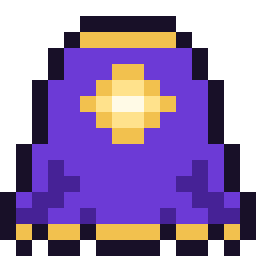

# Flair for Horizon



A native mod for [Horizon](https://github.com/horizon-rust/horizon). Flair adds a cosmetics catalog to the title screen and the pause menu: animated capes, hats, wings, shoulder pets and auras, plus any you make yourself. Cosmetics show on your own player only; other players do not see them.

## Using the catalog

| Where | How |
|---|---|
| Title screen | Click **Flair** (in the row under Multiplayer) |
| In game | Press Esc, then click **Flair** (left of the small icon buttons) |

Pick a tab on the left, then click an item to wear it and click it again to take it off. You can wear one item from each tab at the same time. Your choices are remembered. Every card shows the item itself, turning slowly, and the mouse wheel scrolls through the cards. In a world, the catalog also shows your player on the right wearing everything: drag it with the mouse to turn it around. When you pick a cape or something for your back, it turns to show your back by itself. Close the catalog with the x in its corner, with Esc, or by clicking outside it.

Under the preview, **Wearing** lists what you have on. The x on a row takes that item off. Pets and auras have a **1P** switch: when it is on, you also see them in first person. The **Hide armor** switch at the bottom left hides your armor, so your cosmetics are not covered; it only changes what you see.

Hats grow a little when you wear a helmet, so they always sit on top of it. Wings and pets move out over a chestplate. While you wear something from the Back tab, your cape is hidden so the two never clip into each other.

## What is included

| Tab | Items |
|---|---|
| Capes | HD: Celestial, Inferno, Thunderstorm, Borealis. Classic: Royal, Nebula, Ember, Prism, Frost, Tide, Aurora, Great Wave, Sakura, Storm, Code Rain, Synthwave |
| Hats | Bandanas: Shinobi, Crimson, Shadow, Dragon, Sakura, Galaxy, Neon. Top Hat, Halo, Crown, Devil Horns |
| Back | Angel Wings, Dragon Wings, Phoenix Wings, Katana, Jetpack |
| Pets | Cat, Black Cat, Fox, Owl, Slime, Bee, Mini Dragon, Void Dragon |
| Auras | Halo Rings, Streaks, Orbits, Light Wings, Helix, Rune Circle, Sakura Petals, Spirit Flames, Star Crown, Fire Ring, Lava Ring, Storm Ring, Vortex |

Every cape hangs as cloth: it lifts behind you when you run, swings when you strafe and ripples while you stand. The HD capes are painted at 128x256 so they show no Minecraft pixels. The bandanas carry Japanese script in a real font that runs around your forehead, with animated light, glow and petals, while their tails flow behind you. Wings flap, pets look around, hop or buzz, and auras are drawn with glowing lines that circle, rise and spark around you. Click the colour chip next to your aura in the Wearing list to change its colours.

Bandanas use a Japanese font from your system (Yu Gothic on Windows, Hiragino on macOS, Noto Sans CJK on Linux); without one they fall back to built in pixel glyphs.

## Your own cosmetics

Flair reads your own items from its folder:

```
%APPDATA%\horizon\horizon-mods\.horizon-mod-data\flair\
```

If you play through a launcher instance, it is the same path inside that instance's folder (for example `%APPDATA%\horizon\instances\<instance>\horizon-mods\.horizon-mod-data\flair\`). On Linux and macOS it is the `horizon-mods/.horizon-mod-data/flair/` folder next to your Horizon `options.txt`. Open the catalog again after adding files; they show up at the end of their tab.

### A cape: just a picture

Put a PNG in the `capes` folder.

| Kind | Image size |
|---|---|
| Plain cape | 64x32, the standard Minecraft cape layout |
| HD cape | 128x64, 256x128, 512x256 (shown at 64x32) |
| Animated cape | Frames stacked top to bottom, each half as tall as the image is wide, up to 64 frames |

### Anything else: a Blockbench model

Make the item in [Blockbench](https://www.blockbench.net) as a **Bedrock Entity** model, on top of the standard player model so it sits where you want it, and paint its texture there. Then make a folder for it inside `cosmetics` with these files:

| File | Needed | What it is |
|---|---|---|
| `cosmetic.json` | yes | The name and the tab, see below |
| `<anything>.geo.json` | yes | The model, from File, Export, Export Bedrock Geometry |
| `<anything>.png` | yes | The texture, at most 64x64 |
| `<anything>.animation.json` | no | An animation, from Animation, Export Animations. The first one plays in a loop |
| `<texture>.png.mcmeta` | no | Makes an animated texture play slower, see below |

`cosmetic.json`:

```json
{ "name": "Party Hat", "slot": "hat" }
```

| Key | Values | Default |
|---|---|---|
| `name` | The name shown in the catalog | The folder name |
| `slot` | `hat`, `back`, `pet`, `aura` or `cape` | Required |
| `attach` | `head` (follows the head), `body` (follows the body) or `root` (follows the whole player) | `head` for hats, `body` for back items and pets, `root` for auras |
| `glow` | `true` to keep it bright in the dark | `false` |

Model the item in the player's own coordinates: a hat goes on the player model's head, a pet on its shoulder. The bones keep their pivots and rotations, cubes can use box UV or per face UV, and animations can move, turn and scale any bone with keyframes.

An animated texture is a PNG with its frames stacked top to bottom, each frame as tall as the texture height set in Blockbench. It plays one frame per game tick (20 per second). To slow it down, add a file named like the image plus `.mcmeta`, the same way resource packs do:

```json
{ "animation": { "frametime": 4 } }
```

The repository has a finished example in `examples/cosmetics/party_hat`: copy that folder into `cosmetics` to try it.

If something does not show up, the game's log names the file and the reason.

### Limits

| Limit | Why |
|---|---|
| Textures up to 64x64 | Each cosmetic uses one 64x64 texture slot |
| Animations use keyframes only | Molang expressions are read as 0 |
| One animation per item | The first one in the file plays, in a loop |

## Install

In the Horizon launcher, use Add from GitHub with this repository's link. Then build your native mods in the launcher as usual.

## Build from source

Flair is a `.hmod`: Rust source that the launcher compiles against the prebuilt Horizon build pinned in `horizon-mod.toml` (`[native] horizon`). You need Rust and Horizon's `cargo horizon-mod` tool.

| Command | What it does |
|---|---|
| `cargo horizon-mod check` | Fetches the pinned build's SDK into `.horizon/sdk/` and checks the mod's crate |
| `cargo test --lib` | Runs the tests of the catalog, painting and cosmetic logic |
| `horizon-launcher native-build <this folder> --instance <instance> --trust-native-code` | Compiles the mod, its support modules and mixins against the prebuilt game |
| `cargo horizon-mod build` | Writes `target/horizon-mod/flair.hmod` |
| `python tools/make_example.py` | Writes the example cosmetic in `examples/cosmetics/party_hat` |
| `python tools/make_icon.py` | Redraws `icon.png` |

Made for Horizon Nightly 2026-11-20 (commit `0a875da`). Flair draws on the player through Horizon's own code (seven `[[native.mixin]]` rows and nine support modules), so each Horizon build needs a new version.

## License

MIT. See [LICENSE](LICENSE).
